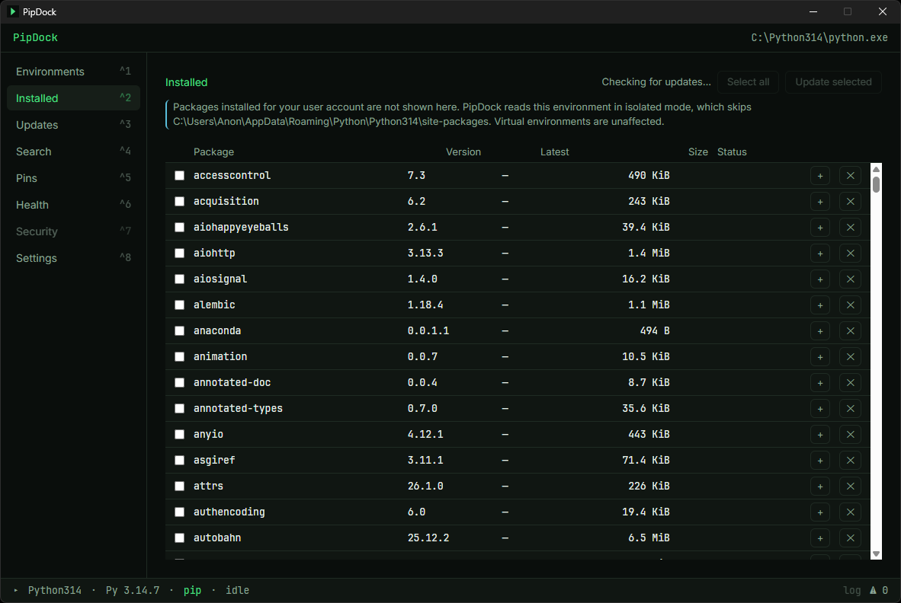
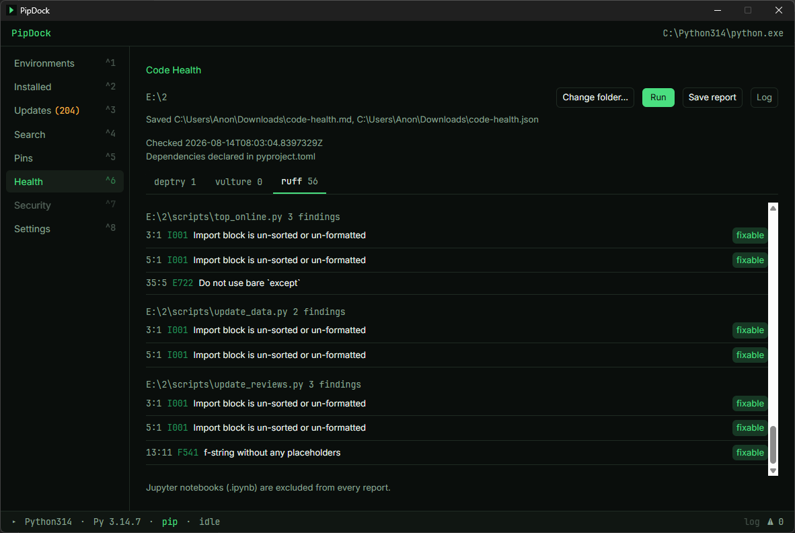
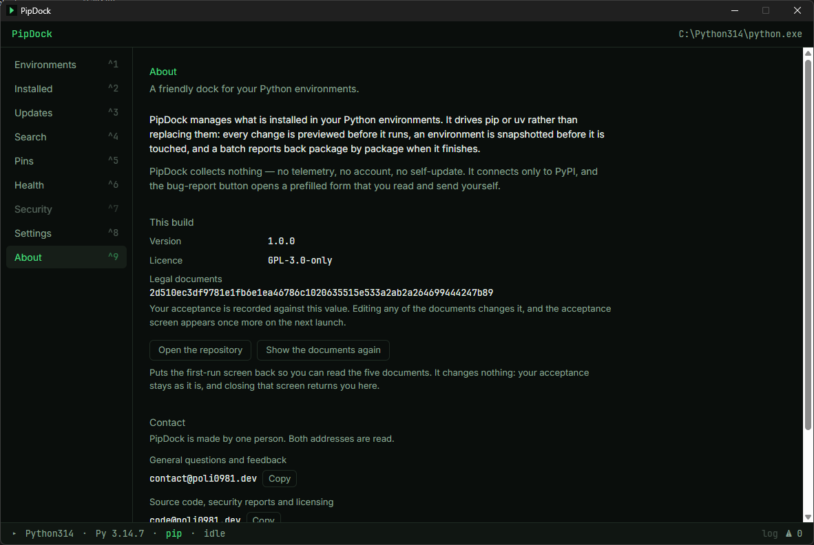
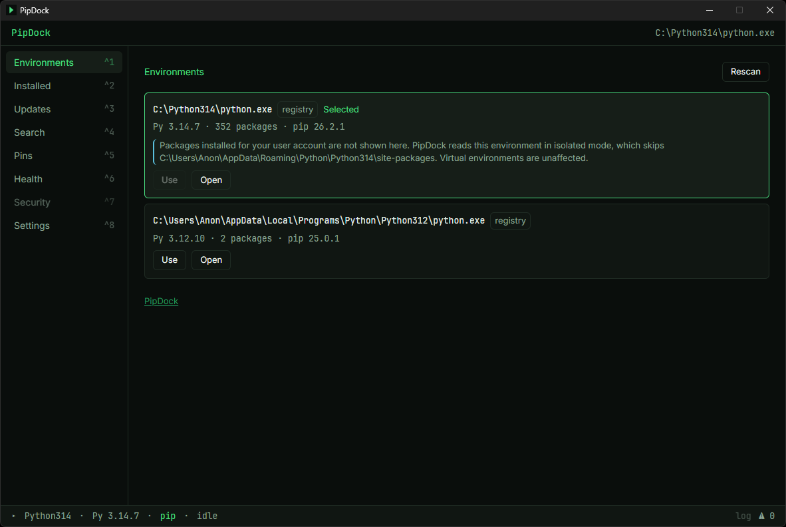
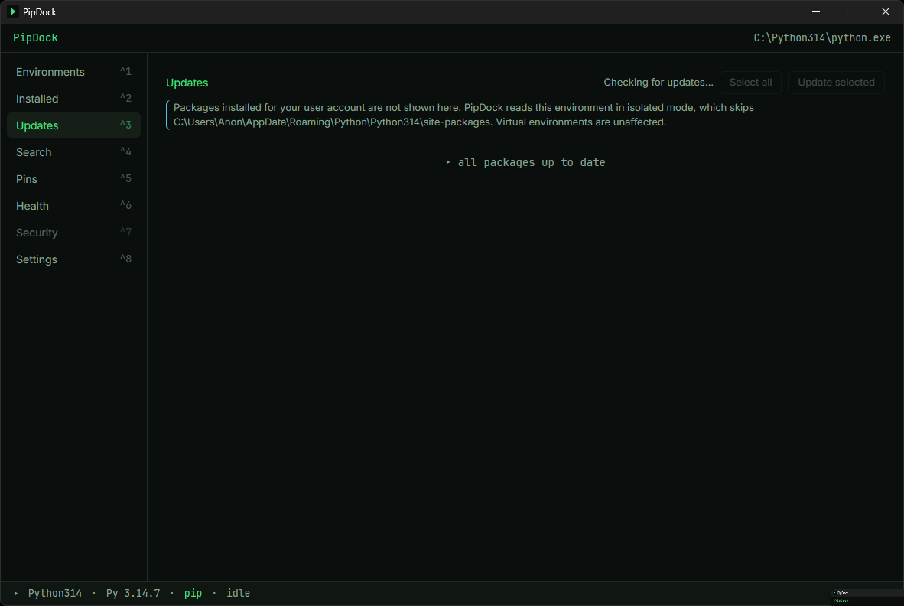
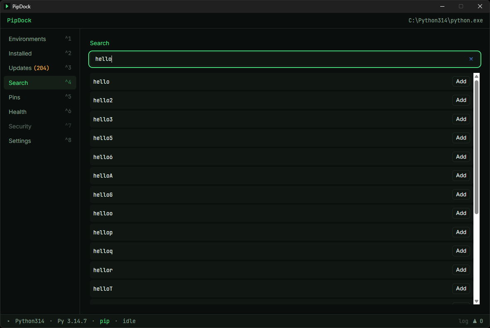
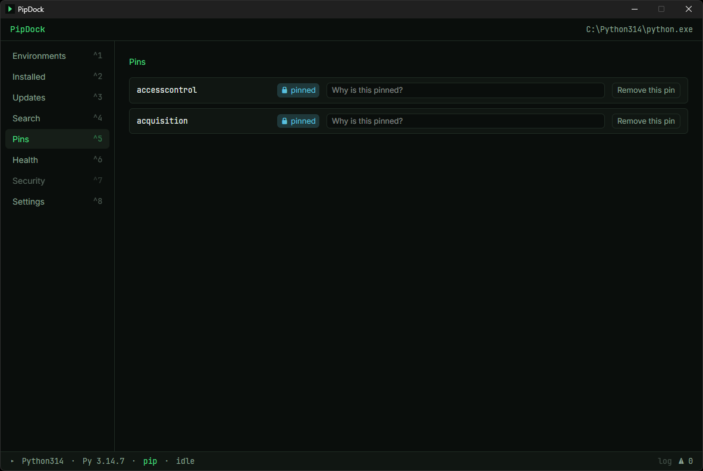
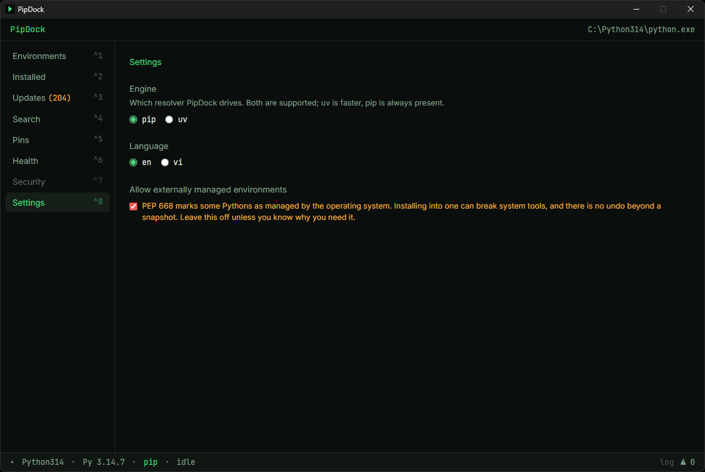

# PipDock

[](https://github.com/poli0981/pipdock/actions/workflows/ci-rust.yml)
[](https://github.com/poli0981/pipdock/actions/workflows/ci-node.yml)
[](https://github.com/poli0981/pipdock/actions/workflows/codeql.yml)
[](https://github.com/poli0981/pipdock/releases)
[](LICENSE)

**A friendly dock for your Python environments.** Inspect, install, update, and clean up Python packages in bulk — through a keyboard-first GUI or a scriptable CLI — without ever hand-typing another `pip install` incantation or guessing why an upgrade broke your project.

> Repo: `poli0981/pipdock` · License: **GPL-3.0-only** · Platform: **Windows 10/11** · Contact: [contact@poli0981.dev](mailto:contact@poli0981.dev) · [other channels](https://poli0981.dev/links/)

---

## Why PipDock

`pip` is powerful but unforgiving: it does not preview what an upgrade will change, `pip uninstall` removes packages that other packages still need without a word of warning, and a failed bulk update leaves you guessing what state your environment is in. PipDock wraps the official resolvers (pip or uv — your choice) with:

- **Preview before touch** — every install/update runs a dry-run resolve first and shows you exactly what will change.
- **Three-way conflict handling** — when the latest version of a package would break another, choose *compatible version* (safe default), *skip*, or *force latest* with a clear "this will break X" warning.
- **Snapshots & rollback** — a `pip freeze` snapshot is taken before every batch operation; one click restores it.
- **Reverse-dependency guard** — uninstalling a package that others depend on triggers a warning listing exactly what would break.
- **Skip-and-continue execution** — one failed package never aborts the batch; you get a final report: *"13 successful, 2 failed"* with per-package reasons.
- **Never touches itself** — PipDock is a standalone binary that lives outside every environment it manages, so it can never break itself mid-update.

## Screenshots







<details>
<summary>Environments, Updates, Search, Pins, Settings</summary>











</details>

## Features

| Area | What you get |
|---|---|
| Environments | Auto-discovery of installed Pythons — the Windows registry (PEP 514), the `py` launcher and the Pythons `uv python list` reports — plus a `.venv`, `venv`, `env` or `.env` folder in the folder PipDock was started from. Adding an environment by path is not in the app yet; the CLI takes any interpreter or environment folder with `--env` |
| PEP 668 guard | Pythons marked externally managed are refused by default. An override in Settings, off by default, asks before it turns on, and while it applies every screen that can change that Python says so |
| Installed | Full package list per env; up-to-date packages dimmed, outdated badged |
| Updates | Bulk update with group dry-run resolve, held-back explanations, 3-way conflict choices. The preview names every package *Force latest* would break, anything left out because it needs a different Python, and withdrawn (yanked) releases |
| Search & Install | Instant fuzzy search over a locally cached PyPI name index (PEP 691), metadata on demand, install queue |
| Uninstall | Bulk uninstall with reverse-dependency warnings |
| Dependencies | For any package on the Installed list: what requires it and what it requires, with the version constraint on each, how many packages removing it would leave broken, and any requirement nothing installed satisfies |
| Pins | Keep packages out of every update until you unpin them, with a reason. The Pins screen suggests packages a lot of your others depend on, and the threshold is configurable |
| Snapshots | Automatic pre-batch snapshots, diff view, one-click rollback |
| Engine | pip **or** uv, chosen in Settings, which shows each one's version for the selected environment (or *not found*). pip is the default; uv has to be on your `PATH` |
| Code Health | deptry + vulture + ruff against a project folder — unused deps, dead code, style — run from PipDock's own isolated tools env |
| Security | pip-audit against an environment's packages: each known advisory with the versions that fix it (or *no fix*), its CVE aliases and a link to its OSV entry, run from PipDock's own isolated audit environment |
| pip upkeep | Check & update pip itself per environment |
| CLI | `pipdock` — full parity for core operations, JSON output, CI-friendly exit codes |
| Requirements | Export an environment as `requirements.txt`; import one and preview what it would install, with every line it will not use reported by number |
| Disk usage | Everything PipDock writes is under `%LOCALAPPDATA%\PipDock\data\`. Settings shows it and clears the parts that are safe to clear — snapshots (`snapshots\`), the Code Health tools environment (`tools\`) and the Security tab's audit environment (`audit\`). `index.db` (package index, settings, pins, your acceptance of the legal documents) is shown but never cleared; the logs (`logs\`) are deleted automatically after 14 days |
| Logs | PipDock keeps its own log, one file per day in `data\logs\`, and never sends it anywhere. It records the commands PipDock ran, so it holds package names and file paths. Settings shows the folder and copies the recent lines for a bug report |
| Keyboard | `Ctrl+K` command palette, `Ctrl+1`–`Ctrl+9` tabs (by key position, so AZERTY and other layouts work too), `/` for Search, full keyboard traversal |
| i18n | English + Tiếng Việt, remembered across restarts |
| Privacy | No telemetry. **PyPI is the only host PipDock connects to.** It does not check for updates, so it never calls home — GitHub, the ruff docs, OSV's advisory pages and the author's links page are only ever handed to your browser as a link you clicked |

## Install

Download the installer (NSIS `.exe` or `.msi`) from [GitHub Releases](https://github.com/poli0981/pipdock/releases).

PipDock does not update itself — grab a new build from the same page when you want one. That is deliberate: a self-updater is a standing remote-code-execution path into a tool that already runs subprocesses against your interpreters, and it is not worth the convenience (see [docs/SECURITY.md](docs/SECURITY.md) §5).

> Windows SmartScreen may warn on first run because the binaries are not EV-code-signed. Every release publishes `SHA256SUMS.txt`; verify your download against it before running (replace `<version>` with the version in the file name you downloaded):
>
> ```powershell
> (Get-FileHash .\PipDock_<version>_x64-setup.exe -Algorithm SHA256).Hash.ToLower()
> ```
>
> Compare that against the matching line in `SHA256SUMS.txt`. If they differ, do not run the file.
>
> From 1.4.0 the `.exe` and `.msi` also carry a build-provenance attestation. A checksum published beside a file cannot prove where the file came from — whoever could replace one could replace both — but the attestation proves the installer was built by this repository's release workflow. With the [GitHub CLI](https://cli.github.com/):
>
> ```powershell
> gh attestation verify .\PipDock_<version>_x64-setup.exe --repo poli0981/pipdock
> ```
>
> It succeeds only when GitHub holds an attestation from this repository for that exact file. If it fails, do not run the file.

## Quick start

**GUI:** launch PipDock → accept the first-run legal gate → pick an environment from the discovered list (the first usable one is already selected; *Use* picks another) → the *Updates* tab shows what's outdated → *Select all* → *Update* → review the preview → *Confirm*. Four clicks.

**CLI:** the installer puts `pipdock.exe` next to the GUI, in `%LOCALAPPDATA%\PipDock\`.
**PipDock does not edit your `PATH`**; add that folder yourself if you want to type `pipdock`
from anywhere:

```powershell
$dir = "$env:LOCALAPPDATA\PipDock"
[Environment]::SetEnvironmentVariable('Path', "$([Environment]::GetEnvironmentVariable('Path','User'));$dir", 'User')
```

```text
pipdock env list
pipdock update --all --env C:\proj\.venv --strategy compatible --yes
pipdock doctor
pipdock snapshot rollback latest
```

## Documentation

**Using PipDock?** The [wiki](https://github.com/poli0981/pipdock/wiki) is the user-facing set —
[Getting Started](https://github.com/poli0981/pipdock/wiki/Getting-Started),
[Troubleshooting](https://github.com/poli0981/pipdock/wiki/Troubleshooting) and an
[FAQ](https://github.com/poli0981/pipdock/wiki/FAQ) that explains the design decisions rather than
just stating them. Everything below is for reading the code.

| Doc | Purpose |
|---|---|
| [docs/PRD.md](docs/PRD.md) | Product goals, personas, feature matrix P0–P2, non-goals |
| [docs/ARCHITECTURE.md](docs/ARCHITECTURE.md) | Crate layout, Engine trait, IPC surface, storage |
| [docs/DATA-FLOW.md](docs/DATA-FLOW.md) | State machines for update / install / uninstall, engine command mapping |
| [docs/UI-SPEC.md](docs/UI-SPEC.md) | Terminal-tech design system, screens, click budgets |
| [docs/CLI-GUIDE.md](docs/CLI-GUIDE.md) | **Start here for the CLI** — what to type, in the order you need it |
| [docs/CLI-SPEC.md](docs/CLI-SPEC.md) | The CLI contract: every flag, exit code and JSON shape |
| [docs/AI-DISCLOSURE.md](docs/AI-DISCLOSURE.md) | Which AI model helped build this, what it did, and how it was reviewed |
| [docs/CODE-HEALTH-SPEC.md](docs/CODE-HEALTH-SPEC.md) | deptry / vulture / ruff integration |
| [docs/ERROR-CATALOG.md](docs/ERROR-CATALOG.md) | Error codes, stderr detection patterns, user guidance |
| [docs/SECURITY.md](docs/SECURITY.md) | Threat model, PEP 668 policy, supply-chain hygiene |
| [docs/TESTING.md](docs/TESTING.md) | Test strategy incl. disposable-venv integration tests |
| [docs/RELEASE-CI.md](docs/RELEASE-CI.md) | CI callers into `poli0981/.github`, release pipeline |
| [docs/I18N.md](docs/I18N.md) | EN/VI localization rules |
| [docs/ROADMAP.md](docs/ROADMAP.md) | Spike week, milestones, exit criteria |
| [legal/](legal/) | EULA, Disclaimer, Privacy Policy, Third-Party Notices (linked by the in-app legal gate) |

## How this was built

PipDock was written with substantial help from an AI coding assistant — **Claude Opus 5** through 1.3.0 and **Claude Opus 5.5** from 1.4.0, made by [Anthropic](https://www.anthropic.com), through [Claude Code](https://claude.com/claude-code) — under human review. It wrote source code, tests, debugging work and the Vietnamese translation. Every change reached `main` through a pull request, and `main` is protected and cannot be bypassed. Through 1.3.0 the maintainer read and merged each one, and drove the built application by hand on three machines before 1.0.0 shipped; 1.4.0 was released by the assistant on the maintainer's written instruction, once its checks had passed.

That review mattered: **thirty-five defects** reached or nearly reached `main`, and not one was caught by the test suite that was green at the time. They were found by running the thing.

Copyright and the GPL-3.0-only licence are unchanged. The full statement — model, vendor, what was and was not delegated, and how to verify any of it from `git log` — is in [docs/AI-DISCLOSURE.md](docs/AI-DISCLOSURE.md).

## License

Copyright © 2026 Kokone (poli0981). PipDock is free software under **GPL-3.0-only** — see [LICENSE](LICENSE). The legal documents in [legal/](legal/) are committed publicly so the in-app legal gate and the About tab can link to them on GitHub.

PipDock is an independent project. It is not affiliated with or endorsed by the Python Software Foundation (Python, pip, PyPI) or Astral (uv, ruff).

---

## Tiếng Việt (tóm tắt)

PipDock là ứng dụng Windows (GUI + CLI) giúp kiểm tra, cài đặt, cập nhật và gỡ **hàng loạt** gói thư viện Python một cách an toàn: luôn chạy dry-run xem trước thay đổi, xử lý xung đột phiên bản với 3 lựa chọn rõ ràng, tự chụp snapshot trước mỗi lần chạy để rollback một chạm, cảnh báo khi gỡ gói mà gói khác đang phụ thuộc, và tổng kết "13 thành công, 2 thất bại" kèm lý do từng gói. Hỗ trợ engine pip hoặc uv (chọn trong Settings), tìm gói tức thì nhờ cache chỉ mục PyPI, kèm module Code Health (deptry/vulture/ruff) để dọn dependency thừa và dead code. Không thu thập dữ liệu. Giấy phép GPL-3.0.
